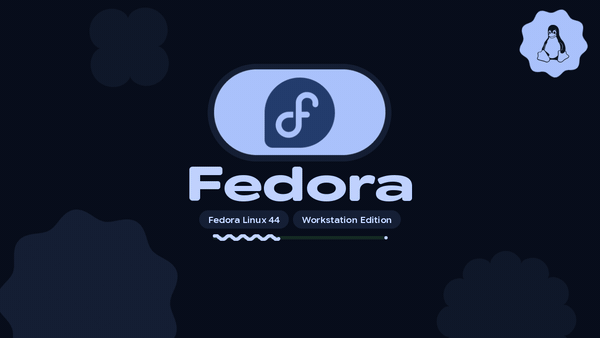
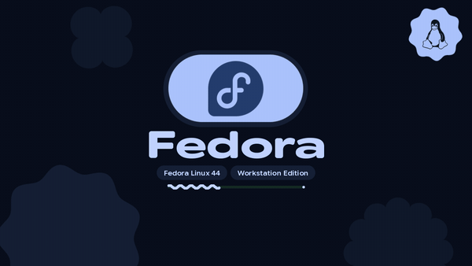
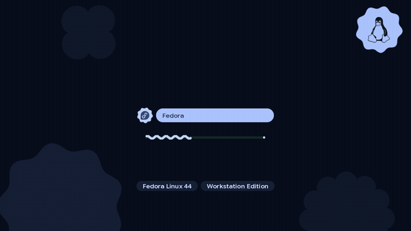
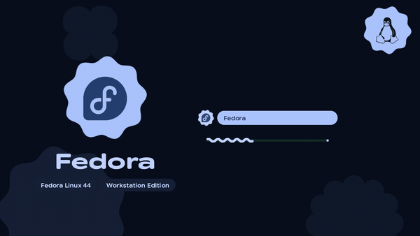

# Material Plymouth

A Material 3 Expressive Plymouth boot splash that continues the [Material GRUB](https://github.com/LucaCraft89/material-grub) theme: the same style, colours, per-distro customisation and animated shapes, with the wavy progress bar, managed from Material GRUB's settings and GUI.

**Status: version 1.0.0, not released yet** (the three repositories, [material-boot-core](https://github.com/LucaCraft89/material-boot-core), [material-grub](https://github.com/LucaCraft89/material-grub) and this one, are released together). The plan and its decisions are in [material-grub/docs/plans/plymouth.md](https://github.com/LucaCraft89/material-grub/blob/release/0.8.0/docs/plans/plymouth.md).

Code: MIT, see [LICENSE](LICENSE).

CI: see [ci/README.md](ci/README.md).

## What it does

- The theme is drawn with Material GRUB's own renderer (it lives in material-boot-core now), so it is the GRUB scene continued: the same distro, colours, names, icons, one-seed colour, `COOKIE` and `LOGO`, with animated shapes and cookie, a Material 3 Expressive wavy progress bar, a disk-password prompt and shutdown and update messages. Four styles (rail and clean, list, split), motion levels `full`, `calm` and `off`.
- It is fitted to the screen it runs on: built for the display's native size, and scaled to fit and centred (never a small scene in a corner) when the screen turns out to be another size.
- `material-boot plymouth apply` renders it, installs it, makes it the default, makes sure Plymouth starts (asks before touching the kernel command line or the mkinitcpio hooks), rebuilds every initramfs and checks each one. **Any failure puts everything back**; `remove` undoes exactly what `apply` did. `status`, `preview` (a still of the boot, password or shutdown screen) and `build DIR` (render only, to look at it) complete the command. `material-grub plymouth ...` works too.

## What it looks like

These are recordings of the real theme **playing in Plymouth** (its X11 renderer under Xvfb), not mock-ups: the wavy bar travelling, the shapes turning and morphing, the cookie, the hero card breathing. Fedora's look, the default colours, motion `full`. Regenerate them with `python3 scripts/make_animations.py docs/animations` (see [ci/README.md](ci/README.md)); CI plays every style and checks that each one really moves.

| rail | clean |
|---|---|
|  |  |
| **list** | **split** |
|  |  |

## Install

Not published yet (it comes out together with material-boot-core and material-grub 1.0.0; the repositories share the version number). It needs only the core (`material-boot-core`), not material-grub. The three package definitions are in `packaging/` (rpm, deb, Arch) and are built and tested in CI. **Installing the package does not change how your system boots**: it puts the code and the plugin manifest in place and nothing else. Turning the splash on rebuilds the initramfs and may edit the kernel command line, so it is your own step: `material-boot plymouth apply` (or the Boot splash page of the GUI), or `material-boot core install --with plymouth` from the bundle. Upgrading re-applies a theme that was applied before (never touching the kernel command line); removing the package takes the theme out first.

From a checkout, without a package: `sudo sh packaging/install-tree.sh . / /usr/local`, then `material-boot plymouth apply`.
- Fedora and openSUSE (dracut), Debian and Ubuntu (initramfs-tools) and Arch (mkinitcpio) are the targets. CI applies and removes the theme against the **real initramfs tool of each of the five distributions**, boots the result in QEMU (Plymouth 22.x to 26.x), and boots GRUB with the Material theme into it; **no real machine has been tested** (real GPUs, real firmware, an encrypted root), so keep a way to recover before applying it.

