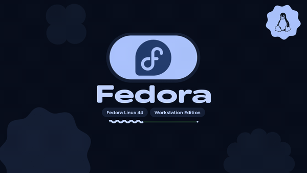
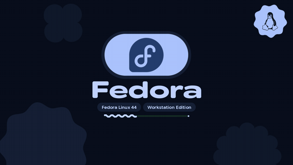
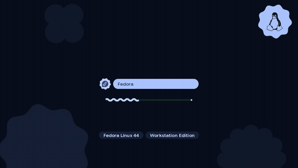
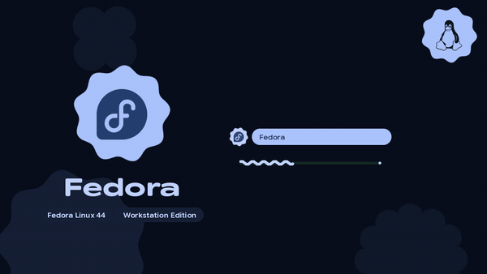

# Material Plymouth 1.0.0

The first release. A boot splash for the moment after the GRUB menu: the same Material 3 Expressive look, colours and distro as your [Material GRUB](https://github.com/LucaCraft89/material-grub) menu, with a wavy loading bar and moving shapes, so the boot looks like one thing and not two.

| rail | clean |
|---|---|
|  |  |
| **list** | **split** |
|  |  |

*These are recordings of the real theme playing in Plymouth, not mock-ups.*

## Highlights
- **It continues your GRUB theme**: same distro, colours, names and icons. You pick the look once.
- **Four styles** (rail, clean, list, split) and three motion levels (full, calm, off).
- **Fits any screen**: built for your display's size, and scaled and centred when the screen turns out to be a different one.
- **Also covered:** the disk-password prompt, shutdown and update screens.
- **Safe to turn on and off**: `material-boot plymouth apply` renders the theme, installs it, rebuilds the initramfs and checks each one. **Any failure puts everything back**; `material-boot plymouth remove` undoes exactly what `apply` did. It asks before touching your kernel command line.
- **Handy extras**: `status`, `preview` (a still picture of the boot, password or shutdown screen) and `build DIR` (render only, install nothing).
- **Managed from Material GRUB's GUI** (a *Boot splash* page) if you use it. Material GRUB is *not* required: Plymouth needs only `material-boot-core`.

## Good to know
- **Installing it does nothing to how you boot.** It only puts the files in place. Boot changes happen when you run `material-boot plymouth apply`.
- For Fedora and openSUSE (dracut), Debian and Ubuntu (initramfs-tools) and Arch (mkinitcpio).

## How we tested it (and what we didn't)
For each of those five distributions, CI applies and removes the theme against the **real initramfs tool** and checks the result, boots it in a virtual machine (Plymouth 22 to 26) and boots GRUB with the Material theme into it. The release bundle installs and removes it in containers on all five.

**Not tested yet:** a real computer (real graphics hardware, real firmware, an encrypted root disk) and immutable systems. Keep a way to recover before you apply it.

## Install
Use the Material Boot bundle from the [material-boot-core 1.0.0 release](https://github.com/LucaCraft89/material-boot-core/releases/tag/v1.0.0):
```
tar xzf material-boot-1.0.0.tar.gz && cd material-boot-1.0.0
sudo ./install.sh --with plymouth
sudo material-boot plymouth apply
```
The rpm, deb and Arch package definitions are in `packaging/` and are built and tested in CI; they are not attached to this release page.
